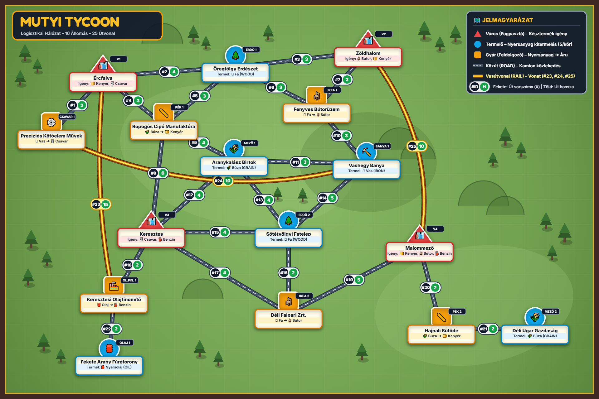

# Mutyi Tycoon - Logisztikai Menedzsment Szimulátor

## Játék összefoglaló
A Mutyi Tycoon egy körökre osztott stratégiai szimulátor. A játékos célja, hogy a megyében létrehozzon egy szállítmányozással foglalkozó céget.

Kezdetben nincs semmije a játékosnak, csak a kezdőtőke. Ebből kell feloldani utakat és járműveket vásárolni. Utána pedig összeállítani a logisztikai útvonalat.

Minden városnak különböző igényei vannak. Ezeket teljesítve juthatunk pénzhez. Ezeket a termékeket a gyárakból kell elhoznunk. A gyáraknak viszont először feldolgozandó nyersanyagra van szüksége. Ezt is a játékosnak kell eljuttatni a gyárba.

Fontos, hogy a megvásárolt járművek után fenntartási költséget kell fizetni. Ha nem figyelünk rá, könnyen csődbe vihetjük a céget.

## Előkövetelmények
* **JDK:** 21 (vagy újabb)
* **Build eszköz:** Maven 3.8+

## Fordítás és Futtatás
A projekt gyökérmappájából az alábbi parancsokkal fordítható és futtatható:

```bash
mvn clean compile
java -cp target/classes org.example.Main
```

## Design Pattern: Command Pattern
A felhasználói beavatkozások és az üzleti logika szétválasztására a **Command (Parancs)** tervezési mintát alkalmaztam az `org.example.command` csomagban.

* **Résztvevő osztályok:**
    * **Command interfész:** [`Command`](src/main/java/org/example/command/Command.java) (`void execute()`).
    * **ConcreteCommand osztályok:**
        * [`BuyVehicleCommand`](src/main/java/org/example/command/BuyVehicleCommand.java) – jármű vásárlása és flottához adása.
        * [`SellVehicleCommand`](src/main/java/org/example/command/SellVehicleCommand.java) – jármű eltávolítása az útról, eladása 50%-os áron.
        * [`UnlockRouteCommand`](src/main/java/org/example/command/UnlockRouteCommand.java) – útvonal feloldási díjának levonása és az út aktiválása.
        * [`SetRouteCargoCommand`](src/main/java/org/example/command/SetRouteCargoCommand.java) – útvonalon szállított árutípus beállítása.
        * [`AssignVehicleCommand`](src/main/java/org/example/command/AssignVehicleCommand.java) – jármű hozzárendelése egy feloldott útvonalhoz.
        * [`NextTurnCommand`](src/main/java/org/example/command/NextTurnCommand.java) – kör léptetése és a csőd (`InsufficientFundsException`) kezelése.
        * [`SaveGameCommand`](src/main/java/org/example/command/SaveGameCommand.java) – játékállás mentésének indítása.
    * **Invoker:** [`ConsoleMenu`](src/main/java/org/example/ui/ConsoleMenu.java) – a felhasználói bemenet beolvasása után példányosítja és végrehajtja a megfelelő parancsot.
    * **Receiver:** [`GameEngine`](src/main/java/org/example/controller/GameEngine.java), [`Company`](src/main/java/org/example/model/Company.java), [`Route`](src/main/java/org/example/model/Route.java), [`Vehicle`](src/main/java/org/example/model/Vehicle.java), [`SaveManager`](src/main/java/org/example/persistence/SaveManager.java).
* **A minta előnye a tervezésben:** A konzolos felület nem manipulálja közvetlenül a domain objektumok belső állapotát és tranzakciós szabályait. Minden felhasználói művelet önálló, tesztelhető és bővíthető parancsobjektumba van zárva.

## Térkép
A játéknak viszonylag nagy térképe van. A könnyebb és átláthatóbb játék érdekében itt egy kép a játék térképéről:



## Készítette
Wittenbart Ádám (C8Y9QE)
